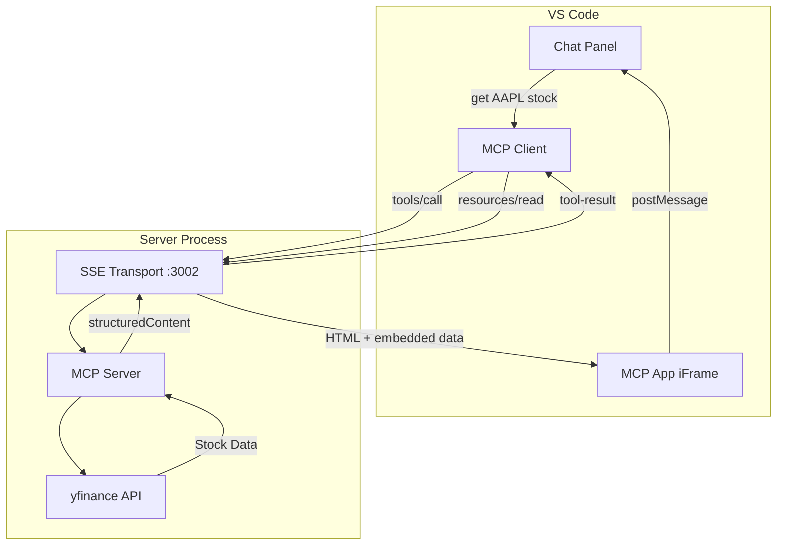
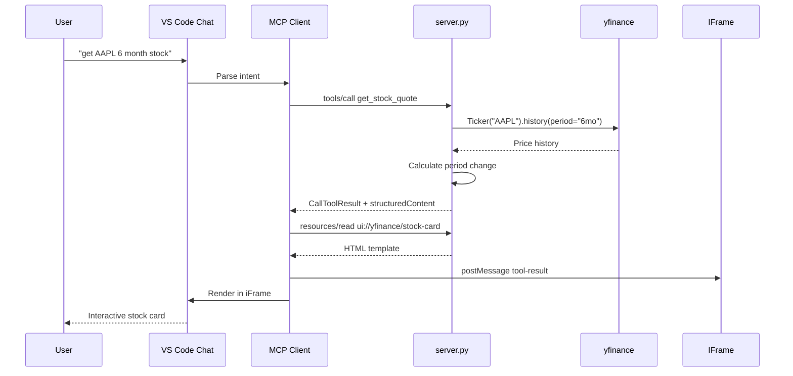

# MCP Apps Stock Server - Architecture Documentation

## Overview

This MCP server provides stock market data via the yfinance API with interactive HTML UIs rendered in VS Code chat using [MCP Apps](https://github.com/modelcontextprotocol/specification/blob/main/docs/draft/apps.md).

---

## Architecture Decision Records

See [doc/architecture/](doc/architecture/README.md) for all ADRs.

---

## System Architecture



## Data Flow



## Component Reference

| Component | File | Responsibility |
|-----------|------|----------------|
| MCP Server | `server.py` | Tool/resource handlers, yfinance integration |
| Stock Card UI | `STOCK_CARD_HTML` | Interactive chart, period buttons, postMessage handshake |
| SSE Transport | `SseServerTransport` | HTTP/SSE communication with VS Code |
| Format Utils | `format_number()` | Human-readable K/M/B/T suffixes |

## API Reference

### Tool: `get_stock_quote`

```json
{
  "name": "get_stock_quote",
  "inputSchema": {
    "ticker": "string (required)",
    "period": "1d|5d|1mo|3mo|6mo|1y (default: 1mo)"
  }
}
```

**Returns:** `structuredContent` with:
- `ticker`, `name`, `price`
- `change`, `changeAmount`, `periodLabel`
- `history[]` - price array for chart
- `volumeFormatted`, `marketCapFormatted`
- `fiftyTwoWeekHigh`, `fiftyTwoWeekLow`

### Resource: `ui://yfinance/stock-card`

- **MIME:** `text/html;profile=mcp-app`
- **Content:** Self-contained HTML with embedded JS
- **Handshake:** `ui/initialize` → `ui/notifications/initialized`
- **Data:** Received via `ui/notifications/tool-result` postMessage

## Quick Commands

```powershell
# Start server
uv run python server.py

# Check port
netstat -ano | Select-String ":3002.*LISTEN"

# Kill and restart
netstat -ano | Select-String ":3002.*LISTEN" | ForEach-Object { 
  if ($_ -match '\s+(\d+)$') { Stop-Process -Id $Matches[1] -Force } 
}
uv run python server.py
```

## VS Code Configuration

### `.vscode/mcp.json`

```json
{
  "servers": {
    "yfinance-http": {
      "type": "sse",
      "url": "http://localhost:3002/sse"
    }
  }
}
```

### Required Settings

```json
{
  "chat.mcp.apps.enabled": true
}
```

## Known Limitations

| Issue | Impact | Workaround |
|-------|--------|------------|
| SSE timeout after idle | Server shows "stopped" | Restart via MCP: List Servers |
| Port 3002 conflict | Server won't start | Kill existing process |
| yfinance rate limits | Slow responses | Cache results client-side |
| MCP Apps VS Code only | No other clients | Use stdio for non-UI clients |
