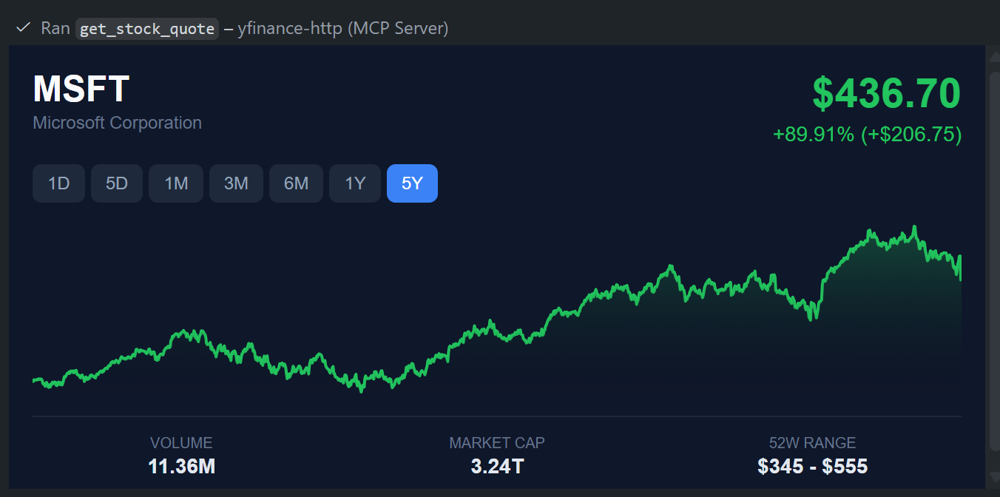
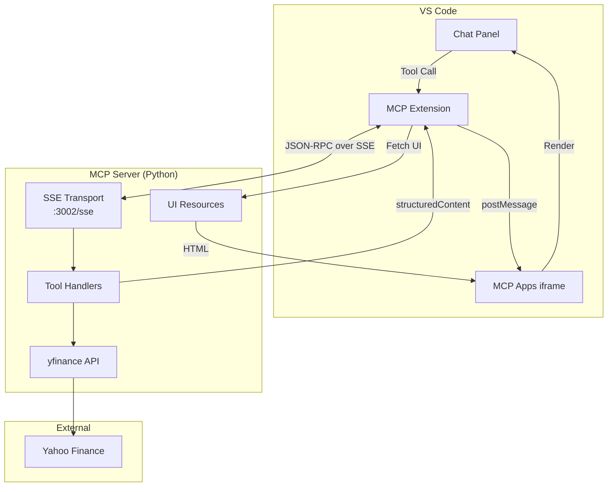
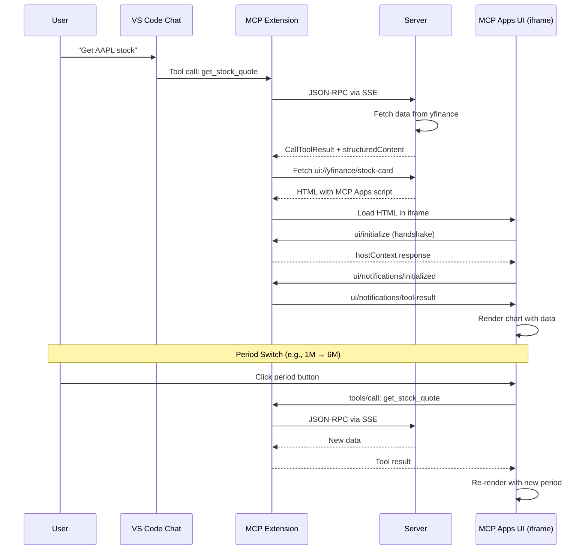
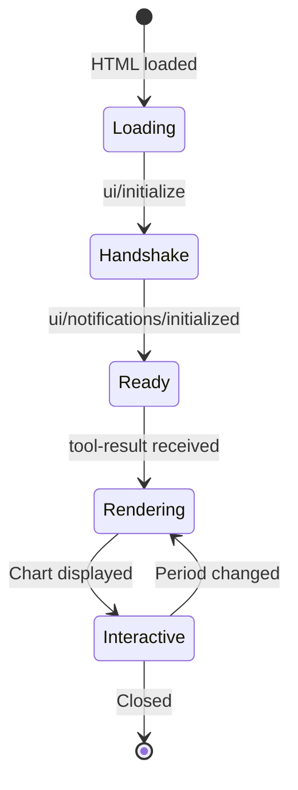

# MCP Apps Example: Stock Quote Server

> **Example Repository** — Learn how to build MCP servers with interactive UI using [MCP Apps](https://github.com/modelcontextprotocol/specification/blob/main/docs/draft/apps.md).

A Model Context Protocol (MCP) server that provides real-time stock market data with interactive HTML UIs rendered directly in VS Code chat.



## Resources

| Resource | Description |
|----------|-------------|
| [MCP Apps Spec](https://github.com/modelcontextprotocol/specification/blob/main/docs/draft/apps.md) | Official specification |
| [VS Code MCP Docs](https://code.visualstudio.com/docs/copilot/chat/mcp-servers) | Using MCP servers in VS Code |
| [VS Code Insiders](https://code.visualstudio.com/insiders/) | Required for MCP Apps |

## Features

- **Real-time Stock Quotes** - Get current prices, changes, and key metrics for any ticker
- **Interactive Charts** - Beautiful price history charts with period switching (1D to 5Y)
- **Stock Comparison** - Compare multiple stocks side-by-side with sparkline charts
- **Rich UI in Chat** - Interactive HTML cards rendered directly in VS Code chat

## Architecture



## MCP Apps Communication Flow



## Project Structure

```
mcp-app/
├── server.py           # MCP server with SSE transport
├── pyproject.toml      # Python dependencies (uv)
├── .vscode/
│   └── mcp.json        # VS Code MCP server configuration
├── .github/
│   ├── copilot-instructions.md
│   └── skills/
│       └── mcp-apps/
│           └── SKILL.md    # MCP Apps development guide
└── AGENTS.md           # Status & troubleshooting
```

## Quick Start

### 1. Prerequisites

- Python 3.10+
- [uv](https://docs.astral.sh/uv/) package manager
- VS Code Insiders with MCP Apps enabled

### 2. Install Dependencies

```bash
uv sync
```

### 3. Start the Server

```bash
uv run python server.py
```

The server starts on `http://localhost:3002/sse`

### 4. Configure VS Code

Create or update `.vscode/mcp.json`:

```json
{
  "servers": {
    "yfinance-http": {
      "type": "sse",
      "url": "http://localhost:3002/sse"
    }
  }
}
```

Enable MCP Apps in VS Code settings:

```json
{
  "chat.mcp.apps.enabled": true
}
```

### 5. Use in Chat

Ask Copilot:
- "Get AAPL stock quote"
- "Compare AAPL, MSFT, GOOGL stocks"
- "Show me 6 month Tesla stock"

## API Reference

### Tools

#### `get_stock_quote`

Get current stock quote with interactive chart UI.

| Parameter | Type | Required | Default | Description |
|-----------|------|----------|---------|-------------|
| `ticker` | string | Yes | - | Stock symbol (e.g., AAPL) |
| `period` | string | No | 1mo | Chart period: 1d, 5d, 1mo, 3mo, 6mo, 1y, 5y |

**Returns:** `structuredContent` with price, change, history, metrics

### Resources

| URI | MIME Type | Description |
|-----|-----------|-------------|
| `ui://yfinance/stock-card` | `text/html;profile=mcp-app` | Interactive stock card UI |
| `ui://yfinance/comparison` | `text/html;profile=mcp-app` | Stock comparison table UI |

## Technical Details

### MCP Apps Integration

The server implements the [MCP Apps specification](https://github.com/modelcontextprotocol/specification/blob/main/docs/draft/apps.md):

1. **Tool Registration with UI Metadata**
   ```python
   Tool(
       name="get_stock_quote",
       inputSchema={...},
       _meta={"ui": {"resourceUri": "ui://yfinance/stock-card"}}
   )
   ```

2. **Resource Registration**
   ```python
   Resource(
       uri="ui://yfinance/stock-card",
       mimeType="text/html;profile=mcp-app"
   )
   ```

3. **Structured Content Return**
   ```python
   CallToolResult(
       content=[TextContent(type="text", text="...")],
       structuredContent={"ticker": "AAPL", "price": 150.0, ...}
   )
   ```

### UI Lifecycle



## Development

### Adding New Tools

1. Register the tool in `list_tools()` with `_meta.ui` pointing to a UI resource
2. Create the UI resource HTML with postMessage handling
3. Register the resource in `list_resources()`
4. Implement the tool handler in `call_tool()`

### UI Template Requirements

- Use `text/html;profile=mcp-app` MIME type
- Implement `ui/initialize` handshake
- Listen for `ui/notifications/tool-result` to receive data
- Do NOT embed data via template strings - data arrives via postMessage

See [SKILL.md](.github/skills/mcp-apps/SKILL.md) for complete MCP Apps development guide.

## Troubleshooting

See [AGENTS.md](AGENTS.md) for current status and common issues.

### Common Issues

| Issue | Solution |
|-------|----------|
| Server disconnects | Restart via `MCP: List Servers` → Restart |
| UI shows "Loading..." | Check `chat.mcp.apps.enabled` setting |
| No chart data | Verify yfinance can reach Yahoo Finance |

## License

MIT
