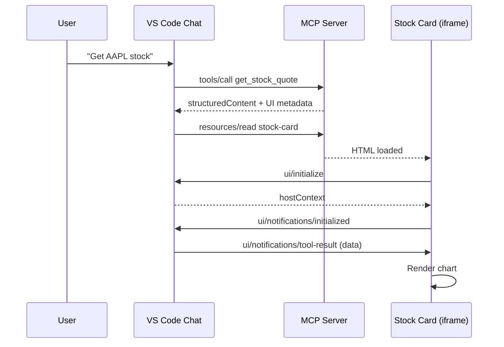

# MCP Apps Example: Stock Quote Server

> **Example Repository** — Learn how to build MCP servers with interactive UI using [MCP Apps](https://github.com/modelcontextprotocol/specification/blob/main/docs/draft/apps.md).

This sample MCP server fetches stock data via yfinance and renders an interactive chart card directly in VS Code chat.


## Resources

| Resource | Description |
|----------|-------------|
| [MCP Apps Spec](https://github.com/modelcontextprotocol/specification/blob/main/docs/draft/apps.md) | Official specification |
| [VS Code MCP Docs](https://code.visualstudio.com/docs/copilot/chat/mcp-servers) | Using MCP servers in VS Code |
| [VS Code Insiders](https://code.visualstudio.com/insiders/) | Required for MCP Apps |

## Quick Start

```bash
# 1. Install dependencies
uv sync

# 2. Start the server
uv run python server.py
```

In VS Code, add to `.vscode/mcp.json`:
```json
{
  "servers": {
    "yfinance-http": {
      "type": "sse",
      "url": "http://localhost:3002/sse"
    }
  }
}
```

Enable in settings: `"chat.mcp.apps.enabled": true`

Then ask Copilot: **"Get AAPL stock quote"**

## What You'll Learn

This example demonstrates the three key MCP Apps patterns:

### 1. Register a Tool with UI Metadata

```python
Tool(
    name="get_stock_quote",
    inputSchema={...},
    _meta={"ui": {"resourceUri": "ui://yfinance/stock-card"}}
)
```

### 2. Return Structured Content

```python
CallToolResult(
    content=[TextContent(type="text", text="AAPL: $150.00")],
    structuredContent={"ticker": "AAPL", "price": 150.0, "history": [...]}
)
```

### 3. Create UI Resource with postMessage Handshake

```python
Resource(
    uri="ui://yfinance/stock-card",
    mimeType="text/html;profile=mcp-app"
)
```

The HTML UI receives data via `ui/notifications/tool-result` postMessage.

## Architecture



## Project Structure

```
├── server.py              # MCP server (SSE transport, tool handlers, UI HTML)
├── pyproject.toml         # Dependencies: mcp, yfinance, starlette, uvicorn
├── .vscode/mcp.json       # VS Code server configuration
└── doc/architecture/      # ADRs for design decisions
```

## Key Files

| File | Purpose |
|------|---------|
| [server.py](server.py) | Complete MCP server implementation |
| [SKILL.md](.github/skills/mcp-apps/SKILL.md) | MCP Apps development guide |
| [AGENTS.md](AGENTS.md) | Troubleshooting & current status |

## Troubleshooting

| Issue | Solution |
|-------|----------|
| Server shows "stopped" | Restart via `MCP: List Servers` |
| UI shows "Loading..." | Enable `chat.mcp.apps.enabled` |
| Port 3002 in use | Kill existing: `netstat -ano \| Select-String ":3002"` |

## License

MIT
